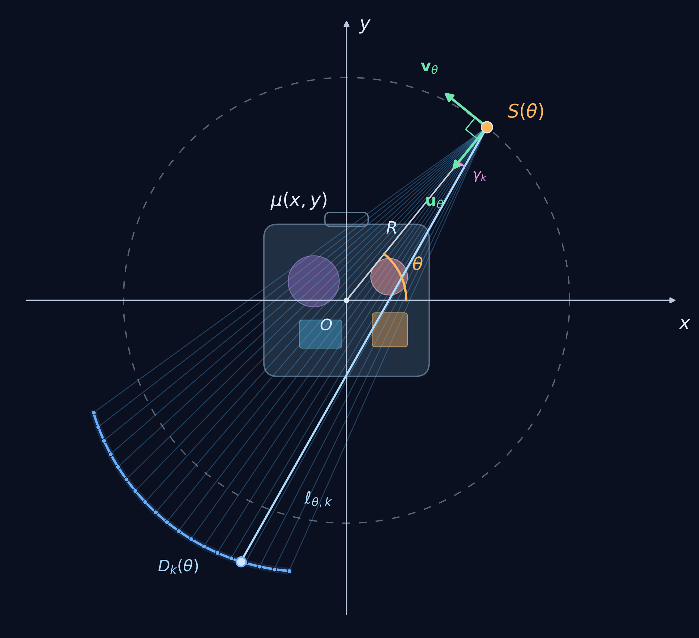

# Numerical Reconstruction

## Постановка задачи
Восстановление распределения коэффициента ослабления рентгеновского излучения по измерениям, полученным в геометрии веерного пучка.

Представим чемодан, который проходит через рентгеновский томограф в аэропорту. Источник излучения и массив детекторов расположены по разные стороны от объекта и поворачиваются вокруг него. Для каждого положения источника детекторы регистрируют интенсивность прошедшего излучения. Из множества таких измерений нужно восстановить внутреннюю структуру одного двумерного сечения чемодана.

## Описание мат модели



### 1. Геометрия сканирования

Опишем координаты трубки, являющейся источником:

$$
S(\theta)=\begin{pmatrix}R\cos\theta\\R\sin\theta\end{pmatrix}
$$

Также введем два единичные вектора (направление на центр и перпендикуляр к нему):

$$
\mathbf u_\theta=\begin{pmatrix}-\cos\theta\\-\sin\theta\end{pmatrix}\qquad
\mathbf v_\theta=\begin{pmatrix}-\sin\theta\\\cos\theta\end{pmatrix}
$$

Детекторы расположены на дуге, центр которой совпадает с источником, на расстоянии $L$ от него. \
Тогда координаты k-го детектора:

$$
D_k(\theta)=S(\theta)+L\bigl(\mathbf u_\theta\cos\gamma_k+\mathbf v_\theta\sin\gamma_k\bigr)
$$

тут за $\gamma_k$ обозначено угловое отклонение луча от центрального направления веера.

Теперь у нас достаточно данных, чтобы задать луч:

$$
r_{\theta, k} (t) = S(\theta) + t(D_k(\theta) - S(\theta))\quad t\in[0,1]
$$


### 2. Прямая задача: от чемодана к измерениям

Ответим на вопрос, что измеряют детекторы. Пусть $\mu(x,y)$ — функция, описывающая коэффициент ослабления в каждой точке сечения. Тогда интенсивность, зарегистрированная k-м детектором при угле $\theta$ по закону Бугера — Ламберта — Бера:

$$
I_{\theta,k}=I_{0,\theta,k}\exp\left(-\int_{\ell_{\theta,k}}\mu(x,y)\,ds\right)
$$

После логарифмирования получаем:

$$
b_{\theta,k}=-\ln\!\frac{I_{\theta,k}}{I_{0,\theta,k}}
=\int_{\ell_{\theta,k}}\mu(x,y)\,ds
$$

Таким образом, каждый детектор сообщает интеграл неизвестной функции вдоль известной прямой.


### 3. Дискретизация: от интегралов к матрице

Разобьём исследуемое сечение на $N=n^2$ квадратных пикселей и будем считать $\mu$ постоянной внутри каждого пикселя, то есть для точек внутри пикселя:

$$
\mu(x,y)\approx\mu_j\quad j=1,\dots,N
$$

Теперь интеграл вдоль луча можно аппроксимировать суммой по пикселям, через которые проходит луч:

$$
\int_{\ell_{\theta,k}}\mu(x,y)\,ds \approx\sum_{j=1}^{N}a_{ij}\mu_j
$$

тут $a_{ij}$ — длина пересечения $i$-го луча с $j$-м пикселем. Собрав измерения всех лучей, получим систему:

$$
A\boldsymbol\mu\approx\mathbf b
\qquad A\in\mathbb R^{M\times N}
$$

### 4. Обратная задача: от измерений к изображению

С учётом ошибок измерений будем использовать модель

$$
\mathbf b=A\boldsymbol\mu_{\mathrm{true}}+\boldsymbol\varepsilon
$$

И тут у нас есть 2 основных требования к решению:
1. **Согласие с измерениями**: $\|A\boldsymbol\mu-\mathbf b\|_2\to\min$
2. **Сложность изображения**: $\boldsymbol\mu$ не должна быть слишком "шумной" или "неровной".

Второе требование удобно описать величиной $\|L\boldsymbol\mu\|_2^2$, где $L$ - выбранная матрица регуляризации.

Задачу поиска экстремума при условии $\|L\boldsymbol\mu\|_2^2 \le \alpha$ можно записать с помощью множителей Лагранжа:

$$
J_\lambda(\boldsymbol\mu)=\|A\boldsymbol\mu-\mathbf b\|_2^2+\lambda\|L\boldsymbol\mu\|_2^2
$$

Обратим внимание на свойства функционала $J_\lambda(\boldsymbol\mu)$:
 - при $\lambda=0$ получаем обычный метод наименьших квадратов;
 - при $\lambda>0$ допускаем некоторое расхождение с измерениями, но получаем более устойчивое решение;
 - при $\lambda\gg 0$ регуляризация начинает доминировать, и слишком сильно искажает полезную информацию;

В работе рассмотрим 2 вида регуляризации:

#### 4.1 Классическая регуляризация Тихонова

Выберем единичную матрицу $E\in\mathbb R^{N\times N}$:

$$
L=E\qquad \|L\boldsymbol\mu\|_2^2=\|\boldsymbol\mu\|_2^2=\sum_{j=1}^{N}\mu_j^2
$$

Это регуляризация Тихонова нулевого порядка. Она штрафует большую норму решения: при сопоставимом согласии с измерениями предпочтение получает распределение с меньшей суммой квадратов коэффициентов ослабления. Такой штраф сдерживает рост неустойчивых компонент решения, вызванный шумом в данных. При этом он непосредственно не учитывает различия между соседними пикселями и сам по себе не задаёт пространственную гладкость.

Соответствующий функционал и задача восстановления:

$$
J_\lambda(\boldsymbol\mu)
=\|A\boldsymbol\mu-\mathbf b\|_2^2+\lambda\|\boldsymbol\mu\|_2^2
=\|A\boldsymbol\mu-\mathbf b\|_2^2+\lambda\sum_{j=1}^{N}\mu_j^2
$$

#### 4.2 Регуляризация по соседним пикселям

Идея заключается в том, чтобы штрафовать резкие изменения коэффициента ослабления между соседними пикселями. Это регуляризация Тихонова первого порядка.

Пусть $\mu_{i,j}$ — коэффициент ослабления в пикселе с индексами $(i,j)$, где $i,j=1,\dots,n$. Будем считать, что индекс $i$ меняется вдоль оси $x$, а $j$ — вдоль оси $y$. Для квадратных пикселей со стороной $h$ соседние разности равны:

$$
\begin{aligned}
\delta_x\mu_{i,j}&=\mu_{i+1,j}-\mu_{i,j}
&&i=1,\dots,n-1\quad j=1,\dots,n\\
\delta_y\mu_{i,j}&=\mu_{i,j+1}-\mu_{i,j}
&&i=1,\dots,n\quad j=1,\dots,n-1
\end{aligned}
$$

Сумма квадратов этих разностей задаёт штраф:

$$
R(\boldsymbol\mu)
=\sum_{i=1}^{n-1}\sum_{j=1}^{n}(\mu_{i+1,j}-\mu_{i,j})^2
+\sum_{i=1}^{n}\sum_{j=1}^{n-1}(\mu_{i,j+1}-\mu_{i,j})^2
$$

Каждая горизонтальная или вертикальная пара соседей учитывается один раз. На границе берём только пары внутри изображения: значения за его пределами не вводим и противоположные края не соединяем.

Связь с производными возникает при рассмотрении достаточно гладкого непрерывного распределения $\mu(x,y)$, которое приближают значения в пикселях. На соответствующих диапазонах индексов:

$$
\left(\frac{\partial\mu}{\partial x}\right)_{i,j}\approx\frac{\delta_x\mu_{i,j}}{h}
\qquad
\left(\frac{\partial\mu}{\partial y}\right)_{i,j}\approx\frac{\delta_y\mu_{i,j}}{h}
$$

Тогда интеграл квадрата нормы градиента по области изображения $\Omega$ приближённо равен:

$$
\begin{aligned}
\int_\Omega\|\nabla\mu(x,y)\|_2^2\,dx\,dy
&\approx h^2\left[
\sum_{i=1}^{n-1}\sum_{j=1}^{n}\left(\frac{\delta_x\mu_{i,j}}{h}\right)^2
+\sum_{i=1}^{n}\sum_{j=1}^{n-1}\left(\frac{\delta_y\mu_{i,j}}{h}\right)^2
\right]\\
&=R(\boldsymbol\mu)
\end{aligned}
$$

Здесь множитель $h^2$ — площадь пикселя; в двумерном случае на квадратной сетке он сокращается с $h^{-2}$ из квадратов разностных производных. Это связь с непрерывной моделью.

Если обозначить дискретный градиент через $\nabla_h=L/h$, то $R(\boldsymbol\mu)=h^2\|\nabla_h\boldsymbol\mu\|_2^2$.

Соответствующий дискретный функционал:

$$
\begin{aligned}
J_\lambda(\boldsymbol\mu)
&=\|A\boldsymbol\mu-\mathbf b\|_2^2+\lambda\|L\boldsymbol\mu\|_2^2\\
&=\|A\boldsymbol\mu-\mathbf b\|_2^2+\lambda R(\boldsymbol\mu)\\
&=\|A\boldsymbol\mu-\mathbf b\|_2^2
+\lambda\left[
\sum_{i=1}^{n-1}\sum_{j=1}^{n}(\mu_{i+1,j}-\mu_{i,j})^2
+\sum_{i=1}^{n}\sum_{j=1}^{n-1}(\mu_{i,j+1}-\mu_{i,j})^2
\right]\\
&=\|A\boldsymbol\mu-\mathbf b\|_2^2+\lambda h^2\|\nabla_h\boldsymbol\mu\|_2^2
\end{aligned}
$$

Такой штраф способствует сглаживанию изображения, но может размывать реальные границы между материалами. Для любого постоянного изображения $\mu_{i,j}=c$ он равен нулю: регуляризация не штрафует постоянный уровень, который должен определяться измерениями.


### 5. Решение задачи восстановления

Для фиксированного $\lambda>0$ ищем минимум функционала $J_\lambda(\boldsymbol\mu)$ по $\boldsymbol\mu\in\mathbb R^N$. Здесь градиент берётся по неизвестным коэффициентам $\mu_1,\dots,\mu_N$; пространственный градиент изображения из пункта 4.2 обозначает другую величину.

Раскроем квадраты норм и вычислим производные обоих слагаемых:

$$
\begin{aligned}
\nabla_{\boldsymbol\mu}J_\lambda(\boldsymbol\mu)
&=\nabla_{\boldsymbol\mu}\left[
(A\boldsymbol\mu-\mathbf b)^{\mathsf T}(A\boldsymbol\mu-\mathbf b)
+\lambda\boldsymbol\mu^{\mathsf T}L^{\mathsf T}L\boldsymbol\mu
\right]\\
&=2A^{\mathsf T}(A\boldsymbol\mu-\mathbf b)
+2\lambda L^{\mathsf T}L\boldsymbol\mu
\end{aligned}
$$

В точке минимума $\boldsymbol\mu_\lambda$ градиент равен нулю. Разделив уравнение на $2$ и перенеся известные величины вправо, получаем систему нормальных уравнений:

$$
2A^{\mathsf T}(A\boldsymbol\mu-\mathbf b)
+2\lambda L^{\mathsf T}L\boldsymbol\mu=\mathbf 0
$$

$$
A^{\mathsf T}A\boldsymbol\mu_\lambda
-A^{\mathsf T}\mathbf b
+\lambda L^{\mathsf T}L\boldsymbol\mu_\lambda=\mathbf 0
$$

$$
\left(A^{\mathsf T}A+\lambda L^{\mathsf T}L\right)
\boldsymbol\mu_\lambda=A^{\mathsf T}\mathbf b
$$

При $\lambda>0$ матрица системы $A^{\mathsf T}A+\lambda L^{\mathsf T}L$ положительно определена и обратима тогда и только тогда, когда

$$
\ker A\cap\ker L=\{\mathbf 0\}
$$

Это означает, что единственный вектор $\mathbf v$, для которого одновременно выполняются $A\mathbf v=\mathbf 0$ и $L\mathbf v=\mathbf 0$, - нулевой. \
Таким образом, при выполнении условий $\ker A\cap\ker L=\{\mathbf 0\}$ и $\lambda>0$ решение единственно и формально записывается как

$$
\boldsymbol\mu_\lambda
=\left(A^{\mathsf T}A+\lambda L^{\mathsf T}L\right)^{-1}A^{\mathsf T}\mathbf b
$$

## Структура проекта
```txt
./
│
├── CMakeLists.txt
├── README.md
├── .gitignore
│
├── include/
│   ├── config.hpp - Параметры эксперимента и геометрии сканирования
│   ├── geometry.hpp - Векторы, сетка и функции для работы с координатами источника, детекторов и лучей
│   ├── scanner.hpp - Координаты источника, детекторов и параметризация лучей
│   ├── phantom.hpp - Создание искусственного сечения чемодана
│   ├── projector.hpp - Реализация алгоритма Сиддона и построение матрицы A
│   ├── regularization.hpp - Построение матрицы регуляризации L
│   ├── reconstruction.hpp - Решение обратной задачи методом Тихонова
│   └── io.hpp - Сохранение изображений, синограмм и результатов экспериментов
│
├── src/
│   ├── main.cpp
│   ├── geometry.cpp
│   ├── phantom.cpp
│   ├── scanner.cpp
│   ├── projector.cpp
│   ├── regularization.cpp
│   ├── reconstruction.cpp
│   └── io.cpp
│
├── tests/
│
└── results/
```