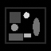
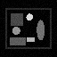
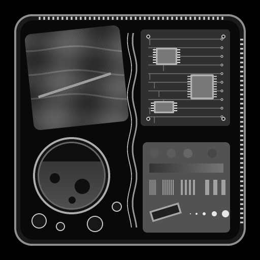
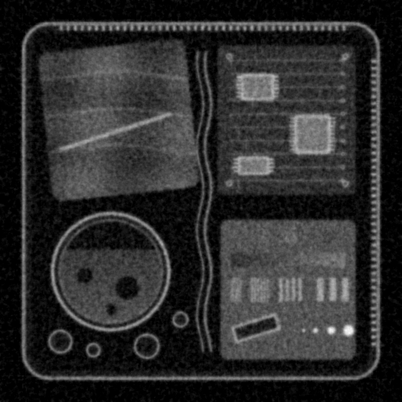
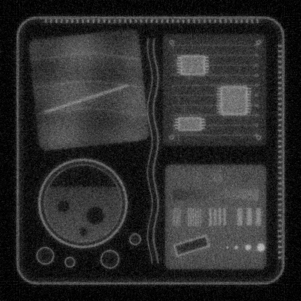

# Numerical Reconstruction

## Постановка задачи
Восстановление распределения коэффициента ослабления рентгеновского излучения по измерениям, полученным в геометрии веерного пучка.

Представим чемодан, который проходит через рентгеновский томограф в аэропорту. Источник излучения и массив детекторов расположены по разные стороны от объекта и поворачиваются вокруг него. Для каждого положения источника детекторы регистрируют интенсивность прошедшего излучения. Из множества таких измерений нужно восстановить внутреннюю структуру одного двумерного сечения чемодана.

## Описание мат модели


### 1. Геометрия сканирования

Опишем координаты трубки, являющейся источником:

```math
S(\theta)=\begin{pmatrix}
R\cos\theta \\
R\sin\theta
\end{pmatrix}
```

Также введем два единичные вектора (направление на центр и перпендикуляр к нему):

```math
\mathbf u_\theta=\begin{pmatrix}
-\cos\theta \\
-\sin\theta
\end{pmatrix}\qquad
\mathbf v_\theta=\begin{pmatrix}
-\sin\theta \\
\cos\theta
\end{pmatrix}
```

Детекторы расположены на расстоянии $L$ от источника на дуге, центр кривизны которой совпадает с источником. \
Тогда координаты k-го детектора:

$$
D_k(\theta)=S(\theta)+L\bigl(\mathbf u_\theta\cos\gamma_k+\mathbf v_\theta\sin\gamma_k\bigr)
$$

тут за $\gamma_k$ обозначено угловое отклонение луча от центрального направления веера.

Теперь у нас достаточно данных, чтобы задать луч:

$$
r_{\theta, k} (t) = S(\theta) + t(D_k(\theta) - S(\theta))\quad t\in[0,1]
$$


### 2. Прямая задача: от чемодана к измерениям

Ответим на вопрос, что измеряют детекторы. Пусть $\mu(x,y)$ — функция, описывающая коэффициент ослабления в каждой точке сечения. Тогда интенсивность, зарегистрированная k-м детектором при угле $\theta$ по закону Бугера — Ламберта — Бера:

$$
I_{\theta,k}=I_{0,\theta,k}\exp\left(-\int_{\ell_{\theta,k}}\mu(x,y)\,ds\right)
$$

После логарифмирования получаем:

$$
b_{\theta,k}=-\ln\frac{I_{\theta,k}}{I_{0,\theta,k}}
=\int_{\ell_{\theta,k}}\mu(x,y)\,ds
$$

Таким образом, каждый детектор сообщает интеграл неизвестной функции вдоль известной прямой.


### 3. Дискретизация: от интегралов к матрице

Разобьём исследуемое сечение на $N=n^2$ квадратных пикселей и будем считать $\mu$ постоянной внутри каждого пикселя, то есть для точек внутри пикселя:

$$
\mu(x,y)\approx\mu_j\quad j=1,\dots,N
$$

Теперь интеграл вдоль луча можно аппроксимировать суммой по пикселям, через которые проходит луч:

$$
\int_{\ell_{\theta,k}}\mu(x,y)\,ds \approx\sum_{j=1}^{N}a_{ij}\mu_j
$$

тут $a_{ij}$ — длина пересечения $i$-го луча с $j$-м пикселем. Собрав измерения всех лучей, получим систему:

$$
A\boldsymbol\mu\approx\mathbf b
\qquad A\in\mathbb R^{M\times N}
$$

### 4 Путь рентгеновского луча: от траектории к матрице пересечений

После разбиения изображения на пиксели измерение для $i$-го луча записывается как

$$
b_i=\sum_j a_{ij}\mu_j
$$

где $\mu_j$ - коэффициент ослабления в j-м пикселе, а $a_{ij}$ - длина пути луча внутри этого пикселя.

Значения $\mu_j$ получаем из входного изображения. Для вычисления геометрических коэффициентов $a_{ij}$ используем алгоритм Сиддона.

Матрица $A$ описывает прохождение лучей через пиксельную сетку:
- каждая строка соответствует одному лучу;
- каждый столбец соответствует одному пикселю;
- ненулевой элемент содержит длину пересечения луча с пикселем;
- нулевой элемент означает отсутствие пересечения положительной длины.

Таким образом, матрица зависит от геометрии сканирования и сетки изображения. При неизменной геометрии её можно использовать для разных распределений коэффициента ослабления.

#### Основная идея

Луч пересекает вертикальные и горизонтальные линии пиксельной сетки. Эти пересечения разбивают его путь на отрезки, каждый из которых принадлежит одному пикселю.

Внутри пикселя коэффициент ослабления считается постоянным. Поэтому вклад такого отрезка в измерение равен произведению его длины на коэффициент ослабления:

$$
\Delta b=\mu_j\,\Delta s
$$

Следовательно, для построения строки матрицы достаточно найти точки пересечения луча с линиями сетки, определить пиксели между соседними пересечениями и вычислить длины соответствующих отрезков.

#### Параметризация луча

Рассмотрим один луч. Пусть источник находится в точке

```math
S = \begin{pmatrix}
s_x \\
s_y
\end{pmatrix},
```

а детектор — в точке

```math
D = \begin{pmatrix}
D_x \\
D_y
\end{pmatrix}.
```

Введём вектор перемещения:

```math
\Delta = D-S = \begin{pmatrix}
\Delta_x \\
\Delta_y
\end{pmatrix}.
```

Путь от источника до детектора задаётся параметрически:

$$
r(t)=S+t\Delta,\qquad t\in[0,1]
$$

В координатах:

$$
x(t)=s_x+t\Delta_x, \qquad y(t)=s_y+t\Delta_y
$$

При $t=0$ получаем положение источника, при $t=1$ — положение детектора.

Параметр $t$ безразмерный. Физическая длина всего отрезка равна

$$
\ell=\|D-S\|_2 = \sqrt{\Delta_x^2+\Delta_y^2}
$$

Отсюда длина участка между параметрами $t_a$ и $t_b$, где $t_b>t_a$, составляет

$$
\Delta s=(t_b-t_a)\ell
$$

Именно эта формула позволяет перейти от параметров пересечения к коэффициентам матрицы.

#### Пиксельная сетка

Пусть область изображения имеет ширину $W$, высоту $H$ и разбита на $n_x$ столбцов и $n_y$ строк. ЧИсло неизвестных $N = n_xn_y$

Для квадратного изображения из предыдущего раздела $n_x = n_y = n$.

Шаги сетки:

$$
h_x=\frac{W}{n_x}, \qquad h_y=\frac{H}{n_y}
$$

Область центрирована в начале координат:

$$
\Omega= \left[-\frac W2,\frac W2\right] \times \left[-\frac H2,\frac H2\right]
$$

Вертикальные линии сетки имеют координаты

$$
x_c=-\frac W2+ch_x, \qquad c=0,\dots,n_x
$$

Строки изображения нумеруются сверху вниз, поэтому горизонтальные линии записываются как

$$
y_r=\frac H2-rh_y, \qquad r=0,\dots,n_y
$$

#### Шаг 1. Ограничение луча областью изображения

Источник и детектор располагаются вне исследуемого сечения. Поэтому сначала определяем часть отрезка, которая находится внутри области изображения.

Для координаты $x$ требуется выполнение условия

$$
-\frac W2\le s_x+t\Delta_x\le\frac W2
$$

Если $\Delta_x\ne0$, пересечения с вертикальными границами области соответствуют параметрам

$$
t_x^{(1)}=\frac{-W/2-s_x}{\Delta_x}
\qquad
t_x^{(2)}=\frac{W/2-s_x}{\Delta_x}
$$

Поскольку направление движения может быть любым, упорядочиваем эти значения:

$$
t_{x,\min}=\min\left(t_x^{(1)},t_x^{(2)}\right)
\qquad
t_{x,\max}=\max\left(t_x^{(1)},t_x^{(2)}\right)
$$

Аналогично для $\Delta_y\ne0$:

$$
t_y^{(1)}=\frac{-H/2-s_y}{\Delta_y}
\qquad
t_y^{(2)}=\frac{H/2-s_y}{\Delta_y}
$$

$$
t_{y,\min}=\min\left(t_y^{(1)},t_y^{(2)}\right)
\qquad
t_{y,\max}=\max\left(t_y^{(1)},t_y^{(2)}\right)
$$

Если обе компоненты направления ненулевые, интервал нахождения луча внутри изображения:

$$
t_{\mathrm{enter}}
=\max\left(0,t_{x,\min},t_{y,\min}\right)
$$

$$
t_{\mathrm{exit}}
=\min\left(1,t_{x,\max},t_{y,\max}\right)
$$

Ограничения $0$ и $1$ учитывают, что рассматривается конечный отрезок от источника до детектора.

Если $t_{\mathrm{enter}}\ge t_{\mathrm{exit}}$

пересечения положительной длины нет. Такой луч не даёт ненулевых коэффициентов матрицы.

При нулевой компоненте направления соответствующая координата постоянна. В этом случае отдельно проверяется её положение относительно области, а деление на ноль не выполняется.

#### Шаг 2. Пересечения с внутренними линиями сетки

После нахождения входа и выхода определяем, где луч пересекает внутренние границы пикселей.

Для вертикальной линии $x=x_c$:

$$
s_x+t\Delta_x=x_c
$$

Следовательно,

$$
t_c^{(x)}=\frac{x_c-s_x}{\Delta_x}
\qquad c=1,\dots,n_x-1
$$

Для горизонтальной линии $y=y_r$:

$$
t_r^{(y)}=\frac{y_r-s_y}{\Delta_y}
\qquad r=1,\dots,n_y-1
$$

Оставляем только пересечения, лежащие строго внутри найденного интервала $t_{\mathrm{enter}}<t<t_{\mathrm{exit}}$

При $\Delta_x=0$ пересечения с вертикальными линиями не вычисляются. При $\Delta_y=0$ аналогично пропускается вычисление пересечений с горизонтальными линиями.

В общий список также добавляем начало и конец пути внутри области:

$$
\mathcal T=
\{t_{\mathrm{enter}},t_{\mathrm{exit}}\}
\cup
\{t_c^{(x)}\}
\cup
\{t_r^{(y)}\}
$$

#### Шаг 3. Упорядочивание пересечений

Сортируем полученные параметры по возрастанию и удаляем совпадающие значения $t_0<t_1<\dots<t_K$

где

$$
t_0=t_{\mathrm{enter}}
\qquad
t_K=t_{\mathrm{exit}}
$$

Совпадения возникают, например, при прохождении через угол пикселя: одна точка одновременно принадлежит вертикальной и горизонтальной линиям сетки.

После упорядочивания каждый интервал $[t_q,t_{q+1}]$

описывает участок пути между двумя соседними границами пикселей.

#### Шаг 4. Определение пикселя

Для каждого интервала выбираем средний параметр:

$$
t_{\mathrm{mid}}
=t_q+\frac{t_{q+1}-t_q}{2}
$$

Вычисляем соответствующую точку:

$$
x_{\mathrm{mid}}=s_x+t_{\mathrm{mid}}\Delta_x
$$

$$
y_{\mathrm{mid}}=s_y+t_{\mathrm{mid}}\Delta_y
$$

Между соседними пересечениями луч не пересекает других линий сетки. Поэтому по этой точке можно определить пиксель, которому принадлежит весь участок пути.

В реализации строка и столбец находятся двоичным поиском по координатам линий сетки. Для горизонтальных линий учитывается убывание координаты $y$ при увеличении номера строки.

Средняя точка используется для определения пикселя. Значение интеграла на участке затем вычисляется через его геометрическую длину и постоянный коэффициент ослабления.

#### Шаг 5. Вычисление длины пересечения
Для участка между $t_q$ и $t_{q+1}$ длина равна $\Delta s_q=(t_{q+1}-t_q)\ell$

Если участок принадлежит пикселю $j_q$, его длина задаёт коэффициент $a_{i,j_q}$

После обработки всех интервалов получаем ненулевые элементы строки матрицы для рассматриваемого луча.

#### Лучи на границах пикселей

Если луч проходит вдоль линии сетки, необходимо однозначно определить, какой стороне принадлежит его вклад. Иначе один путь может быть учтён дважды.

В реализации принято следующее правило принадлежности пикселю:

$$
[x_c,x_{c+1})
\times
(y_{r+1},y_r]
$$

Следовательно:
- левая и верхняя границы принадлежат пикселю;
- правая и нижняя границы ему не принадлежат;
- луч вдоль внутренней вертикальной границы учитывается в пикселях справа;
- луч вдоль внутренней горизонтальной границы учитывается в пикселях снизу.
Пути вдоль внешних правой и нижней границ области исключаются. Пути вдоль внешних левой и верхней границ учитываются.

Изолированное касание границы в одной точке имеет нулевую длину и не даёт вклада в интеграл.

Это соглашение задаёт поведение дискретной модели в случаях, когда луч лежит непосредственно на разрыве между пиксельными значениями.

#### Построение разреженной матрицы

Для каждого положения источника перебираем все детекторы и выполняем описанную трассировку.

При нумерации с нуля номер измерения в программе определяется как
```
measurement = view * num_detectors + detector;
```
Индекс пикселя при построчном хранении изображения:
```
pixel_index = row * pixels_x + col;
```

Каждое пересечение записывается тройкой:
```
Triplet(measurement, pixel_index, length)
```
После обработки всех лучей эти тройки объединяются в матрицу $A\in\mathbb R^{M\times N}$

где $M=N_{\mathrm{angles}}N_{\mathrm{detectors}}, \qquad N=n_xn_y$

Один луч проходит только через часть пикселей, поэтому большая часть элементов \(A\) равна нулю. В программе используется разреженная матрица `Eigen::SparseMatrix<double>`.

Размерности величин согласованы:

$$
[a_{ij}]=\text{длина}
\qquad
[\mu_j]=\frac1{\text{длина}}
\qquad
[b_i]=1
$$

Таким образом, произведение $A\boldsymbol\mu$ даёт безразмерные логарифмированные измерения.

#### Точность вычислений

Для принятого кусочно-постоянного распределения $\mu_h(x,y)$ интеграл вдоль луча выражается через найденные длины:

$$
\int_{\ell_i}\mu_h(x,y)\,ds = \sum_{j=1}^{N}a_{ij}\mu_j
$$

В точной арифметике это равенство выполняется точно. Ошибка приближения реального непрерывного объекта возникает при его представлении пиксельной картой. Отдельно присутствуют ошибки вычислений с плавающей точкой.

Алгоритм не требует выбирать постоянный шаг продвижения вдоль луча: разбиение пути определяется самими границами пикселей. Поэтому длины пересечений вычисляются непосредственно из геометрии.

В реализации параметры пересечений и промежуточные координаты вычисляются в типе `long double`, а коэффициенты матрицы сохраняются в `double`. Повышенная промежуточная точность снижает риск потери коротких интервалов, особенно около углов пикселей. При этом исходные координаты сетки и луча уже представлены числами `double`.

Совпадения параметров удаляются через `std::unique`: объединяются только точно равные вычисленные значения. Близкие положительные интервалы специально не склеиваются по допуску. Если после преобразования длины в double получается ноль, такой участок пропускается.

Параметр точности решателя обратной задачи не используется при построении пересечений: точность решения системы и обработка геометрии относятся к разным этапам вычислений.

#### Вычислительная сложность
В данной реализации для каждого луча перебираются внутренние вертикальные и горизонтальные линии сетки. Число рассматриваемых пересечений имеет порядок $O(n_x+n_y)$

Затем параметры сортируются, а для каждого интервала выполняется двоичный поиск пикселя. В результате сложность трассировки одного луча составляет $O\bigl((n_x+n_y)\log(n_x+n_y)\bigr)$

Для квадратной сетки $n\times n$: $O(n\log n)$

Построение матрицы требует обработки всех $M$ лучей. Разреженное хранение позволяет сохранять только ненулевые длины пересечений. Во время сборки дополнительно хранится список троек, поэтому пиковое потребление памяти превышает размер готовой матрицы.

### 5. Обратная задача: от измерений к изображению

С учётом ошибок измерений будем использовать модель

$$
\mathbf b=A\boldsymbol\mu_{\mathrm{true}}+\boldsymbol\varepsilon
$$

И тут у нас есть 2 основных требования к решению:
1. **Согласие с измерениями**: $\Vert A\boldsymbol\mu-\mathbf b\Vert_2\to\min$
2. **Сложность изображения**: $\boldsymbol\mu$ не должна быть слишком "шумной" или "неровной".

Второе требование удобно описать величиной $\Vert L\boldsymbol\mu\Vert_2^2$, где $L$ - выбранная матрица регуляризации.

Задачу поиска экстремума при условии $\Vert L\boldsymbol\mu\Vert_2^2 \le \alpha$ можно записать с помощью множителей Лагранжа:

$$
J_\lambda(\boldsymbol\mu)=\Vert A\boldsymbol\mu-\mathbf b\Vert_2^2+\lambda\Vert L\boldsymbol\mu\Vert_2^2
$$

Обратим внимание на свойства функционала $J_\lambda(\boldsymbol\mu)$:
 - при $\lambda=0$ получаем обычный метод наименьших квадратов;
 - при $\lambda>0$ допускаем некоторое расхождение с измерениями, но получаем более устойчивое решение;
 - при $\lambda\gg 0$ регуляризация начинает доминировать, и слишком сильно искажает полезную информацию;

В работе рассмотрим 2 вида регуляризации:

#### 5.1 Классическая регуляризация Тихонова

Выберем единичную матрицу $E\in\mathbb R^{N\times N}$:

$$
L=E\qquad \Vert L\boldsymbol\mu\Vert_2^2=\Vert\boldsymbol\mu\Vert_2^2=\sum_{j=1}^{N}\mu_j^2
$$

Это регуляризация Тихонова нулевого порядка. Она штрафует большую норму решения: при сопоставимом согласии с измерениями предпочтение получает распределение с меньшей суммой квадратов коэффициентов ослабления. Такой штраф сдерживает рост неустойчивых компонент решения, вызванный шумом в данных. При этом он непосредственно не учитывает различия между соседними пикселями и сам по себе не задаёт пространственную гладкость.

Соответствующий функционал и задача восстановления:

$$
J_\lambda(\boldsymbol\mu)
=\Vert A\boldsymbol\mu-\mathbf b\Vert_2^2+\lambda\Vert\boldsymbol\mu\Vert_2^2
=\Vert A\boldsymbol\mu-\mathbf b\Vert_2^2+\lambda\sum_{j=1}^{N}\mu_j^2
$$

#### 5.2 Регуляризация по соседним пикселям

Идея заключается в том, чтобы штрафовать резкие изменения коэффициента ослабления между соседними пикселями. Это регуляризация Тихонова первого порядка.

Пусть $\mu_{i,j}$ — коэффициент ослабления в пикселе с индексами $(i,j)$, где $i,j=1,\dots,n$. Будем считать, что индекс $i$ меняется вдоль оси $x$, а $j$ — вдоль оси $y$. Для квадратных пикселей со стороной $h$ соседние разности равны:

```math
\begin{aligned}
\delta_x\mu_{i,j}&=\mu_{i+1,j}-\mu_{i,j}
&&i=1,\dots,n-1\quad j=1,\dots,n\\
\delta_y\mu_{i,j}&=\mu_{i,j+1}-\mu_{i,j}
&&i=1,\dots,n\quad j=1,\dots,n-1
\end{aligned}
```

Сумма квадратов этих разностей задаёт штраф:

$$
R(\boldsymbol\mu)
=\sum_{i=1}^{n-1}\sum_{j=1}^{n}(\mu_{i+1,j}-\mu_{i,j})^2
+\sum_{i=1}^{n}\sum_{j=1}^{n-1}(\mu_{i,j+1}-\mu_{i,j})^2
$$

Каждая горизонтальная или вертикальная пара соседей учитывается один раз. На границе берём только пары внутри изображения: значения за его пределами не вводим и противоположные края не соединяем.

Связь с производными возникает при рассмотрении достаточно гладкого непрерывного распределения $\mu(x,y)$, которое приближают значения в пикселях. На соответствующих диапазонах индексов:

$$
\left(\frac{\partial\mu}{\partial x}\right)_{i,j}\approx\frac{\delta_x\mu_{i,j}}{h}
\qquad
\left(\frac{\partial\mu}{\partial y}\right)_{i,j}\approx\frac{\delta_y\mu_{i,j}}{h}
$$

Тогда интеграл квадрата нормы градиента по области изображения $\Omega$ приближённо равен:

```math
\begin{aligned}
\int_\Omega\Vert\nabla\mu(x,y)\Vert_2^2\,dx\,dy
&\approx h^2\left[
\sum_{i=1}^{n-1}\sum_{j=1}^{n}\left(\frac{\delta_x\mu_{i,j}}{h}\right)^2
+\sum_{i=1}^{n}\sum_{j=1}^{n-1}\left(\frac{\delta_y\mu_{i,j}}{h}\right)^2
\right]\\
&=R(\boldsymbol\mu)
\end{aligned}
```

Здесь множитель $h^2$ — площадь пикселя; в двумерном случае на квадратной сетке он сокращается с $h^{-2}$ из квадратов разностных производных. Это связь с непрерывной моделью.

Если обозначить дискретный градиент через $\nabla_h=L/h$, то $R(\boldsymbol\mu)=h^2\Vert\nabla_h\boldsymbol\mu\Vert_2^2$.

Соответствующий дискретный функционал:

```math
\begin{aligned}
J_\lambda(\boldsymbol\mu)
&=\Vert A\boldsymbol\mu-\mathbf b\Vert_2^2+\lambda\Vert L\boldsymbol\mu\Vert_2^2\\
&=\Vert A\boldsymbol\mu-\mathbf b\Vert_2^2+\lambda R(\boldsymbol\mu)\\
&=\Vert A\boldsymbol\mu-\mathbf b\Vert_2^2
+\lambda\left[
\sum_{i=1}^{n-1}\sum_{j=1}^{n}(\mu_{i+1,j}-\mu_{i,j})^2
+\sum_{i=1}^{n}\sum_{j=1}^{n-1}(\mu_{i,j+1}-\mu_{i,j})^2
\right]\\
&=\Vert A\boldsymbol\mu-\mathbf b\Vert_2^2+\lambda h^2\Vert\nabla_h\boldsymbol\mu\Vert_2^2
\end{aligned}
```

Такой штраф способствует сглаживанию изображения, но может размывать реальные границы между материалами. Для любого постоянного изображения $\mu_{i,j}=c$ он равен нулю: регуляризация не штрафует постоянный уровень, который должен определяться измерениями.


### 6. Решение задачи восстановления

Для фиксированного $\lambda>0$ ищем минимум функционала $J_\lambda(\boldsymbol\mu)$ по $\boldsymbol\mu\in\mathbb R^N$. Здесь градиент берётся по неизвестным коэффициентам $\mu_1,\dots,\mu_N$; пространственный градиент изображения из пункта 4.2 обозначает другую величину.

Раскроем квадраты норм и вычислим производные обоих слагаемых:

```math
\begin{aligned}
\nabla_{\boldsymbol\mu}J_\lambda(\boldsymbol\mu)
&=\nabla_{\boldsymbol\mu}\left[
(A\boldsymbol\mu-\mathbf b)^{\mathsf T}(A\boldsymbol\mu-\mathbf b)
+\lambda\boldsymbol\mu^{\mathsf T}L^{\mathsf T}L\boldsymbol\mu
\right]\\
&=2A^{\mathsf T}(A\boldsymbol\mu-\mathbf b)
+2\lambda L^{\mathsf T}L\boldsymbol\mu
\end{aligned}
```

В точке минимума $\boldsymbol\mu_\lambda$ градиент равен нулю. Разделив уравнение на $2$ и перенеся известные величины вправо, получаем систему нормальных уравнений:

$$
2A^{\mathsf T}(A\boldsymbol\mu-\mathbf b)
+2\lambda L^{\mathsf T}L\boldsymbol\mu=\mathbf 0
$$

$$
A^{\mathsf T}A\boldsymbol\mu_\lambda
-A^{\mathsf T}\mathbf b
+\lambda L^{\mathsf T}L\boldsymbol\mu_\lambda=\mathbf 0
$$

$$
\left(A^{\mathsf T}A+\lambda L^{\mathsf T}L\right)
\boldsymbol\mu_\lambda=A^{\mathsf T}\mathbf b
$$

При $\lambda>0$ матрица системы $A^{\mathsf T}A+\lambda L^{\mathsf T}L$ положительно определена и обратима тогда и только тогда, когда

$$
\ker A\cap\ker L=\{\mathbf 0\}
$$

Это означает, что единственный вектор $\mathbf v$, для которого одновременно выполняются $A\mathbf v=\mathbf 0$ и $L\mathbf v=\mathbf 0$, - нулевой. \
Таким образом, при выполнении условий $\ker A\cap\ker L=\{\mathbf 0\}$ и $\lambda>0$ решение единственно и формально записывается как

$$
\boldsymbol\mu_\lambda
=\left(A^{\mathsf T}A+\lambda L^{\mathsf T}L\right)^{-1}A^{\mathsf T}\mathbf b
$$

### 7. Моделирование шума

Идеальное измерение для $i$-го луча:

$$
b_i^{\mathrm{ideal}}=(A\boldsymbol\mu_{\mathrm{true}})_i.
$$

При среднем числе падающих фотонов $I_0>0$ закон Бугера - Ламберта - Бера задаёт среднее число фотонов на детекторе:

$$
I_i=I_0e^{-b_i^{\mathrm{ideal}}}.
$$

Числа зарегистрированных фотонов $K_i$ генерируем независимо по закону Пуассона:

$$
\mathbb P(K_i=k)=\frac{I_i^k}{k!}e^{-I_i},\qquad k=0,1,2,\dots
$$

Обратное логарифмирование даёт шумное измерение:

$$
b_i^{\mathrm{noisy}}=\ln\frac{I_0}{\max(K_i,1)}.
$$

Нулевой отсчёт заменяем на $1$, чтобы логарифм был определён.

Таким образом моделируются шумы в измерениях, вызванные дискретностью фотонов и статистикой Пуассона.

## Примеры запуска

### 1. Чемодан 64x64, точные измерения, первый порядок
```
./build/numerical-reconstruction \
    --input input/low/04_suitcase.pgm \
    --pixels-x 64 --pixels-y 64 \
    --num-angles 180 --num-detectors 128 \
    --regularization first-order --lambda 0.01 \
    --epsilon 1e-8 --max-iterations 2000 \
    --output output/examples/01_ideal
```

<table width="100%">
  <tr>
    <th width="50%">Оригинальное изображение</th>
    <th width="50%">Реконструированное изображение</th>
  </tr>
  <tr>
    <td width="50%" align="center">
      
    </td>
    <td width="50%" align="center">
      
    </td>
  </tr>
</table>

### 2. Тот же чемодан с шумом Пуассона: 10000 падающих фотонов на луч
```
./build/numerical-reconstruction \
    --input input/low/04_suitcase.pgm \
    --pixels-x 64 --pixels-y 64 \
    --num-angles 180 --num-detectors 128 \
    --regularization first-order --lambda 0.01 \
    --poisson-noise --incident-photon-count 10000 --random-seed 42 \
    --output output/examples/02_noisy_first_order
```

<table width="100%">
  <tr>
    <th width="50%">Оригинальное изображение</th>
    <th width="50%">Реконструированное изображение</th>
  </tr>
  <tr>
    <td width="50%" align="center">
      
    </td>
    <td width="50%" align="center">
      
    </td>
  </tr>
</table>

### 3. Нулевой порядок на тех же шумных измерениях: можно сравнить с примером 2 (seed не менялся)
```
./build/numerical-reconstruction \
    --input input/low/04_suitcase.pgm \
    --pixels-x 64 --pixels-y 64 \
    --num-angles 180 --num-detectors 128 \
    --regularization zero-order --lambda 0.01 \
    --poisson-noise --incident-photon-count 10000 --random-seed 42 \
    --output output/examples/03_noisy_zero_order
```

<table width="100%">
  <tr>
    <th width="50%">Оригинальное изображение</th>
    <th width="50%">Реконструированное изображение</th>
  </tr>
  <tr>
    <td width="50%" align="center">
      
    </td>
    <td width="50%" align="center">
      
    </td>
  </tr>
</table>

### 4. Более детализированное изображение 512x512, шум Пуассона: 2500 фотонов на луч, первый порядок

```bash
./build/numerical-reconstruction \
    --input input/sp/multiscale_phantom_512.pgm \
    --pixels-x 512 --pixels-y 512 \
    --image-width 2 --image-height 2 \
    --radius 2.5 --detector-distance 5.5 \
    --num-angles 360 --num-detectors 768 \
    --start-angle 0 --scan-angle 6.283185307179586 \
    --half-fan-angle 0.6108652381980153 \
    --regularization first-order --lambda 0.03 \
    --epsilon 1e-8 --max-iterations 2000 \
    --poisson-noise --incident-photon-count 2500 --random-seed 42 \
    --output output/sp_first_order
```

<table width="100%">
  <tr>
    <th width="50%">Оригинальное изображение</th>
    <th width="50%">Реконструкция: первый порядок</th>
  </tr>
  <tr>
    <td width="50%" align="center">
      
    </td>
    <td width="50%" align="center">
      
    </td>
  </tr>
</table>

### 5. Нулевой порядок на тех же шумных измерениях: сравнение с примером 4

Геометрия, шум, seed и λ совпадают с примером 4; меняются только порядок регуляризации

```bash
./build/numerical-reconstruction \
    --input input/sp/multiscale_phantom_512.pgm \
    --pixels-x 512 --pixels-y 512 \
    --image-width 2 --image-height 2 \
    --radius 2.5 --detector-distance 5.5 \
    --num-angles 360 --num-detectors 768 \
    --start-angle 0 --scan-angle 6.283185307179586 \
    --half-fan-angle 0.6108652381980153 \
    --regularization zero-order --lambda 0.03 \
    --epsilon 1e-8 --max-iterations 2000 \
    --poisson-noise --incident-photon-count 2500 --random-seed 42 \
    --output output/sp_zero_order
```

<table width="100%">
  <tr>
    <th width="50%">Оригинальное изображение</th>
    <th width="50%">Реконструкция: нулевой порядок</th>
  </tr>
  <tr>
    <td width="50%" align="center">
      
    </td>
    <td width="50%" align="center">
      
    </td>
  </tr>
</table>

### 6. Первый порядок с увеличенным λ: сглаживание и потеря мелких деталей

Увеличим λ с 0.03 до 0.3, сохранив геометрию и шум примера 4. Более сильный штраф на соседние разности сглаживает изображение, но размывает границы и мелкие детали, допуская большее расхождение с измерениями

```bash
./build/numerical-reconstruction \
    --input input/sp/multiscale_phantom_512.pgm \
    --pixels-x 512 --pixels-y 512 \
    --image-width 2 --image-height 2 \
    --radius 2.5 --detector-distance 5.5 \
    --num-angles 360 --num-detectors 768 \
    --start-angle 0 --scan-angle 6.283185307179586 \
    --half-fan-angle 0.6108652381980153 \
    --regularization first-order --lambda 0.3 \
    --epsilon 1e-8 --max-iterations 2000 \
    --poisson-noise --incident-photon-count 2500 --random-seed 42 \
    --output output/sp_first_order_hl
```

<table width="100%">
  <tr>
    <th width="50%">Оригинальное изображение</th>
    <th width="50%">Реконструкция: первый порядок, λ = 0.3</th>
  </tr>
  <tr>
    <td width="50%" align="center">
      
    </td>
    <td width="50%" align="center">
      
    </td>
  </tr>
</table>

### 7. Нулевой порядок с увеличенным λ: подавление амплитуды и потеря контраста

Увеличим λ с 0.03 до 0.3 при тех же измерениях, что в примере 5. Нулевой порядок сильнее уменьшает норму решения и снижает контраст; пространственная гладкость непосредственно этим штрафом не задаётся

```bash
./build/numerical-reconstruction \
    --input input/sp/multiscale_phantom_512.pgm \
    --pixels-x 512 --pixels-y 512 \
    --image-width 2 --image-height 2 \
    --radius 2.5 --detector-distance 5.5 \
    --num-angles 360 --num-detectors 768 \
    --start-angle 0 --scan-angle 6.283185307179586 \
    --half-fan-angle 0.6108652381980153 \
    --regularization zero-order --lambda 0.3 \
    --epsilon 1e-8 --max-iterations 2000 \
    --poisson-noise --incident-photon-count 2500 --random-seed 42 \
    --output output/sp_zero_order_hl
```

<table width="100%">
  <tr>
    <th width="50%">Оригинальное изображение</th>
    <th width="50%">Реконструкция: нулевой порядок, λ = 0.3</th>
  </tr>
  <tr>
    <td width="50%" align="center">
      
    </td>
    <td width="50%" align="center">
      
    </td>
  </tr>
</table>
